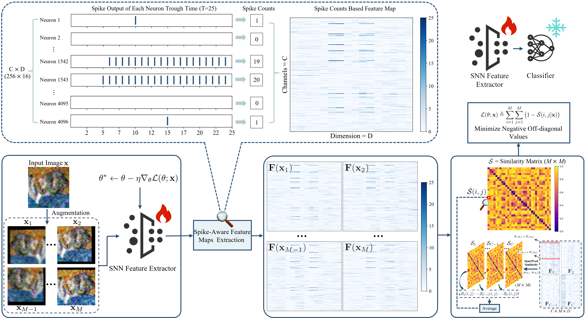

# SPACE

Official implementation of [SPACE: SPike-Aware Consistency Enhancement for Test-Time Adaptation in Spiking Neural Networks](https://papers.neurips.cc/paper_files/paper/2025/file/3d9f111e9139bb008ffdfc6b466f3bf5-Paper-Conference.pdf) (NeurIPS 2025).

<p align="center">
  
</p>

## Preparation

Install PyTorch and torchvision, then point each script at your data and checkpoints.

Corruption datasets follow the CIFAR-C / Tiny-ImageNet-C layout (severity 5). Edit the hardcoded roots before running:

| Setting             | Data path in code                                                                                |
| ------------------- | ------------------------------------------------------------------------------------------------ |
| CIFAR-10 VGG9       | `/path/to/cifar10` and `/path/to/cifar10/CIFAR-10-C` in `cifar10/bntt/main.py`             |
| CIFAR-10 ResNet-11  | `--data` for clean CIFAR-10; `/path/to/cifar10/CIFAR-10-C` in `cifar10/r11/dataprocess.py` |
| CIFAR-100 VGG11     | `/path/to/cifar100` and `/path/to/cifar100/CIFAR-100-C` in `cifar100/bntt/main.py`         |
| Tiny-ImageNet VGG11 | `/path/to/tiny-imagenet-200/val` and `/path/to/Tiny-ImageNet-C` in `tinyimagenet/bntt/main.py` |

Place the pretrained weights at:

- `cifar10/bntt/modelsave/cifar10vgg9_timestep25_lr0.3_epoch100_leak0.95_bestmodel.pth.tar`
- `cifar10/r11/model_bestT1_cifar10_r11.pth.tar`
- `cifar100/bntt/modelsave/cifar100vgg11_timestep30_lr0.3_epoch100_leak0.99_bestmodel.pth.tar`
- `tinyimagenet/bntt`: `/path/to/tinyimagenet_vgg11.pth.tar`

`run_test.sh` evaluates the pretrained model with no adaptation. `run_adapt.sh` runs SPACE test-time adaptation. Both loop over corruption types. Change `--gpu` in the shell script if needed.

## Run

```bash
# CIFAR-10, VGG9-BNTT
cd cifar10/bntt
bash run_test.sh
bash run_adapt.sh

# CIFAR-10, ResNet-11
cd cifar10/r11
bash run_test.sh
bash run_adapt.sh

# CIFAR-100, VGG11-BNTT
cd cifar100/bntt
bash run_test.sh
bash run_adapt.sh

# Tiny-ImageNet, VGG11-BNTT
cd tinyimagenet/bntt
bash run_test.sh
bash run_adapt.sh
```

## Citation

```bibtex
@inproceedings{luo2025space,
  title={SPACE: SPike-Aware Consistency Enhancement for Test-Time Adaptation in Spiking Neural Networks},
  author={Luo, Xinyu and Chen, Kecheng and Sun, Pao-Sheng Vincent and Tian, Chris Xing and Basu, Arindam and Li, Haoliang},
  booktitle={Advances in Neural Information Processing Systems},
  year={2025}
}
```
